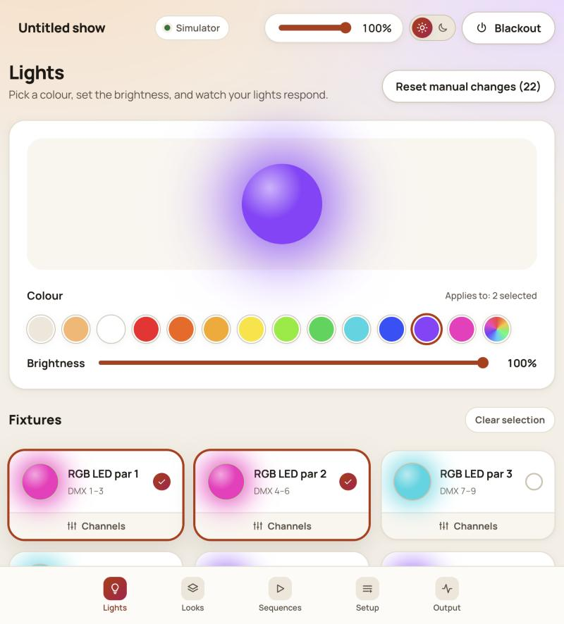

# Open DMX Stage

**Light your show from the browser.** Colour your fixtures, save looks, and chain them into sequences with smooth
fades. Works with USB-DMX cables, the ENTTEC DMX USB Pro, Art-Net and sACN, or a built-in simulator when you have no hardware.



## Features

- **Colour studio:** quick colours, a custom colour picker and brightness, applied to all or selected fixtures.
- **Looks:** save what is on stage and recall it with a configurable fade.
- **Sequences:** chain looks with fade and hold times, loop them, and watch a visual timeline.
- **Setup:** auto-addressing, conflict warnings, and fixture import from QLC+ (`.qxf`) and Open Fixture Library
  (`.json`) files.
- **Output monitor:** a live view of all 512 DMX channels.
- **Master and blackout** that affect brightness only, never pan or tilt.
- **Light and dark themes**, a first-run welcome, and a responsive layout for phones and tablets.
- **Many outputs:** passive FTDI USB-DMX cables (such as the DSD TECH SH-RS09B), ENTTEC DMX USB Pro and DMXKing,
  Art-Net and sACN, chosen from the app with no configuration files.
- **Simulator mode:** try everything without lights or a dongle.

## Quick start

```bash
git clone https://github.com/langecornu2027/open-dmx-stage.git
cd open-dmx-stage
npm install
npm run dev
```

Open http://localhost:5173. Requires Node.js 24 LTS (Node 20 also works for development).

- **[Install guide](docs/INSTALL.md):** dependencies, connecting a DMX interface, configuration, troubleshooting.
- **[Usage guide](docs/USAGE.md):** a tour of every screen, with screenshots.
- **[Connecting your lights](docs/CONNECTION.md):** a beginner-friendly guide to adapters, wiring and setup. It is also
  built into the app (Output screen, **How to connect**).

## Real lights

Open the **Output** screen, choose your interface (USB-DMX cable, ENTTEC Pro, Art-Net or sACN), pick the port or enter
an address, and press **Connect**. Supported interfaces, platform notes and troubleshooting are in the
[install guide](docs/INSTALL.md#4-connect-real-dmx-lights) and the
full [connection guide](docs/CONNECTION.md). USB output is experimental and untested on real hardware so
far.

## Scripts

| Command                          | What it does                                       |
| -------------------------------- | -------------------------------------------------- |
| `npm run dev`                    | API on :4000 and web app on :5173 with live reload |
| `npm run build` then `npm start` | Production build, served from one port (:4000)     |
| `npm test`                       | Unit and API tests (`node:test`)                   |
| `npm run lint`                   | ESLint                                             |
| `npm run format`                 | Prettier                                           |

## How it works

- `server/services/dmxEngine.js` layers a running look or sequence under live manual changes, applies master and
  blackout to brightness channels only, and sends one 512-slot frame per tick (default 30 Hz).
- Drivers live in `server/clients/` (`mock`, `open-dmx`, `enttec-pro`, `artnet`, `sacn`). Add another by implementing
  `open`, `send`, `close` and `getStatus`, then register it in `server/services/outputManager.js`.
- The browser sends fader moves over a WebSocket (`/live`) and receives the live frame and engine state.
- Your show is one JSON document (`server/data/project.json`), validated with zod and saved atomically.
- `shared/patch.js` resolves fixtures to absolute DMX channels for both the server and the browser.

## Project status

Version 0.1. One universe. Planned: more DMX interfaces, a beat-synced timeline, and export to other lighting systems. Issues and pull requests are welcome.

## Contributing

See [docs/CODING_STANDARDS.md](docs/CODING_STANDARDS.md) for the code style, testing and review rules.
Run `npm run lint`, `npm test` and `npm run build` before opening a pull request.

## Security

The server has no authentication and is meant for your own machine or a trusted local network. It restricts browser
origins, validates all input and rate limits the API, but do not expose it to the internet.

## Credits

Built on open source software; see [ATTRIBUTIONS.md](ATTRIBUTIONS.md) for the full list and format credits. This
project is independent and is not affiliated with ENTTEC, inMusic (SoundSwitch, Engine DJ, Denon DJ), QLC+ or the
Open Fixture Library.

## License

MIT. See [LICENSE](LICENSE).
