# Connecting your lights

This guide explains, step by step and in plain language, how to get Open DMX Stage talking to real lights. You do not
need any lighting experience. If you only want to try the app, skip all of this: the **Simulator** needs no hardware.

<!-- Keep in sync with the in-app guide: the pages in src/components/guide/. -->

> **Prefer to read it inside the app?** Open the **Output** screen and press **How to connect** in the Connection card.
> The same guide opens in a window, already on the page for the interface you selected.

Contents: [The big picture](#1-the-big-picture) · [Which interface?](#2-which-interface-do-i-need) ·
[Passive or active?](#3-passive-or-active-usb-adapters) · [Before you start](#4-before-you-start) ·
[Setup by interface](#5-setup-step-by-step) · [Wiring and addresses](#6-wiring-and-addresses) ·
[Test it](#7-test-your-connection) · [Status messages](#8-what-the-status-messages-mean) ·
[Troubleshooting](#9-troubleshooting) · [Glossary](#10-glossary) · [FAQ](#11-faq)

## 1. The big picture

**DMX** is the language that stage lights understand. Your computer cannot speak it directly, so you need an
**adapter** in between. The app works out what each light should do (a list of 512 numbers from 0 to 255, called
**channels**) and sends that list to the adapter about 30 times a second. The adapter turns it into DMX, and the lights
pass it along one to the next.

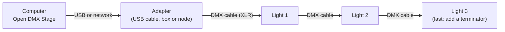

The **Connection** card on the **Output** screen is where you tell the app which kind of adapter you have.

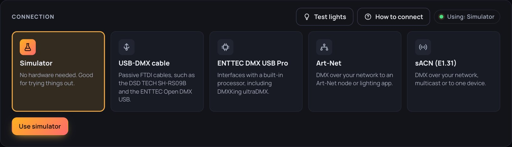

## 2. Which interface do I need?

Pick the row that matches what you own. The five buttons at the top of the Connection card map to these choices.

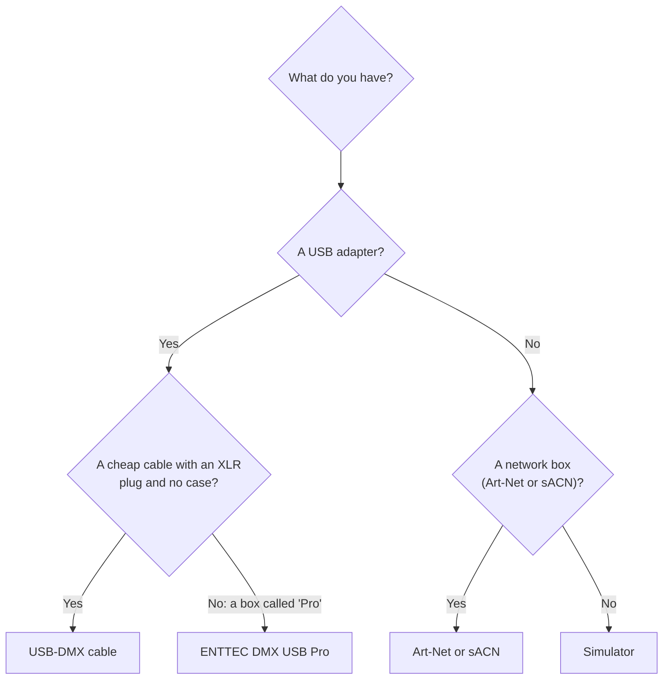

| What you have                                                             | Choose                  | Notes                                                             |
| ------------------------------------------------------------------------- | ----------------------- | ----------------------------------------------------------------- |
| Cheap USB cable with an XLR plug (DSD TECH SH-RS09B, ENTTEC Open DMX USB) | **USB-DMX cable**       | Experimental. See [section 3](#3-passive-or-active-usb-adapters). |
| USB box described as "Pro" (ENTTEC DMX USB Pro, DMXKing ultraDMX)         | **ENTTEC DMX USB Pro**  | Steady timing.                                                    |
| Network box (Art-Net or sACN node)                                        | **Art-Net** or **sACN** | The most predictable option.                                      |
| Nothing yet                                                               | **Simulator**           | Try the app with no hardware.                                     |

SoundSwitch's own dongles (Micro DMX, Control One) use a proprietary protocol and are **not supported**.

## 3. Passive or active USB adapters?

USB-to-DMX adapters come in two families. They look alike, but they work differently, and the app has to speak to them
differently. A wrong choice is unlikely to cause harm and the lights simply will not respond, but this has not been
tested on real equipment, so unplug your lights from the cable while you experiment if you want to be careful.

|                         | **Passive** (cheap cable)                         | **Active** (has a processor)                         |
| ----------------------- | ------------------------------------------------- | ---------------------------------------------------- |
| Also called             | "Open DMX" style, no microcontroller              | "Pro", microcontroller-based, buffered               |
| Examples                | DSD TECH SH-RS09B, ENTTEC Open DMX USB            | ENTTEC DMX USB Pro, DMXKing ultraDMX Micro or Pro    |
| Inside                  | A USB-serial chip and a line driver, nothing else | A small computer that builds the DMX signal itself   |
| Who makes the timing    | Your computer, bit by bit, all the time           | The adapter. The computer only sends the 512 values. |
| If the computer is busy | Lights may flicker or glitch                      | Output stays steady                                  |
| Price                   | Usually the cheapest option                       | Usually several times more                           |
| Choose in this app      | **USB-DMX cable**                                 | **ENTTEC DMX USB Pro**                               |

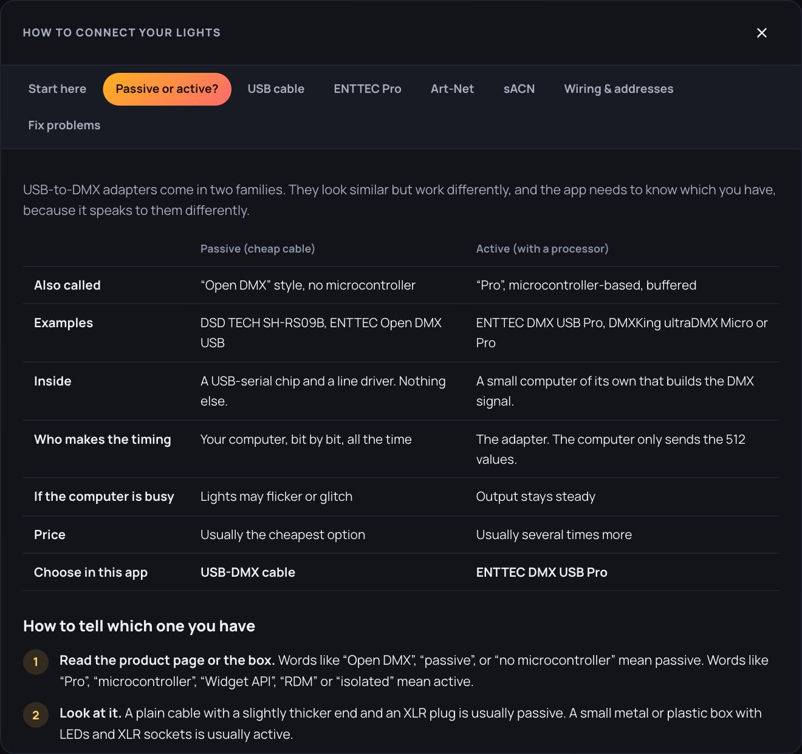

### How to tell which one you have

1. **Read the product page or box.** "Open DMX", "passive" or "no microcontroller" means passive. "Pro",
   "microcontroller", "Widget API", "RDM" or "isolated" means active.
2. **Look at it.** A plain cable with a slightly thicker end and an XLR plug is usually passive. A small metal or
   plastic box with LEDs and XLR sockets is usually active.
3. **Think about the price.** A very cheap adapter is almost always passive.
4. **Check another program.** In QLC+ or similar software, the driver menu lists "Open DMX USB" and "DMX USB Pro"
   separately. Whichever one makes your lights respond tells you the type.
5. **Ask the adapter.** On the **Output** screen choose **USB-DMX cable**, pick the port and press **Detect adapter**.
   The app asks the adapter to identify itself: an adapter with its own processor (ENTTEC Pro style) answers, and a
   passive cable stays silent. The app then selects the matching interface for you. Silence is a strong hint, not
   proof (a wrong port or a busy device is silent too), and this check has not been tried on real hardware yet.
6. **Try it here.** Choose one type and press **Connect**. If the lights stay dark, switch to the other type and try
   again. Only the correct one works.

> **Heads up:** in the port list, both kinds can show an **FTDI cable** label, because both use the same USB chip. The
> label does not tell you which type you have.

If you own both, prefer the active adapter or a network interface for shows. Passive cables work, but they depend on
your computer staying quiet, so test them well before an event.

## 4. Before you start

Tick these off first. Most connection problems come from one of them.

- [ ] The app is running and open in your browser (see the [install guide](INSTALL.md)).
- [ ] You added your lights in **Setup**, and noted each light's **DMX address**.
- [ ] You set the **same address and mode** on each real light (see [section 6](#6-wiring-and-addresses)).
- [ ] No other lighting program (QLC+, Lightkey, Freestyler, and so on) is using the adapter. Only one program can use a
      USB adapter at a time.
- [ ] The DMX cable goes from the adapter's **OUT** to the first light's **IN**.
- [ ] Each light is in **DMX mode** (not sound-active, auto or master/slave).

## 5. Setup, step by step

### 5.1 Simulator (no hardware)

1. Open **Output**.
2. In the Connection card, choose **Simulator** and press **Use simulator**.
3. The top bar shows **Simulator**. Everything in the app works; nothing is sent to real lights.

### 5.2 USB-DMX cable (DSD TECH SH-RS09B and other passive cables)

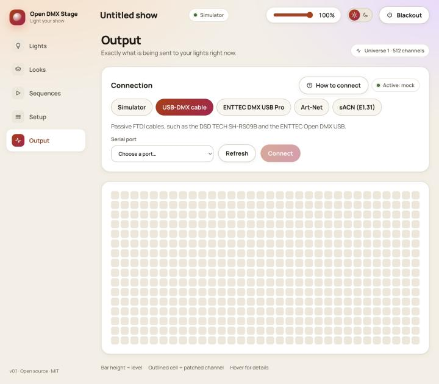

1. **Close other lighting programs.**
2. **Plug the USB end directly into the computer** (avoid hubs) and the XLR end into the first light's **DMX IN**.
3. Open **Output** and choose **USB-DMX cable**.
4. **Pick the Serial port.** Not sure which is yours? Press **Refresh**, unplug the cable, press Refresh again, plug it
   back in and press Refresh once more. The entry that disappears and returns is your cable. FTDI cables are labelled. Not sure the interface type is right?
   Press **Detect adapter** and the app will check and choose for you.
5. Press **Connect**. The top bar should change to **DMX ready**.
6. Press **Test lights** on the same card. Every light you have added in Setup cycles through red, green, blue and
   white; press **Stop test** when you are done. If a light does not follow, check its address and mode.
7. Go to **Lights**, pick a colour, and check the real light changes.

What the port is called:

| System  | Looks like                                                                                                       |
| ------- | ---------------------------------------------------------------------------------------------------------------- |
| macOS   | `/dev/tty.usbserial-XXXX`                                                                                        |
| Windows | `COM3` (any COM number)                                                                                          |
| Linux   | `/dev/ttyUSB0` (you may need to join the `dialout` group: `sudo usermod -aG dialout $USER`, then log out and in) |

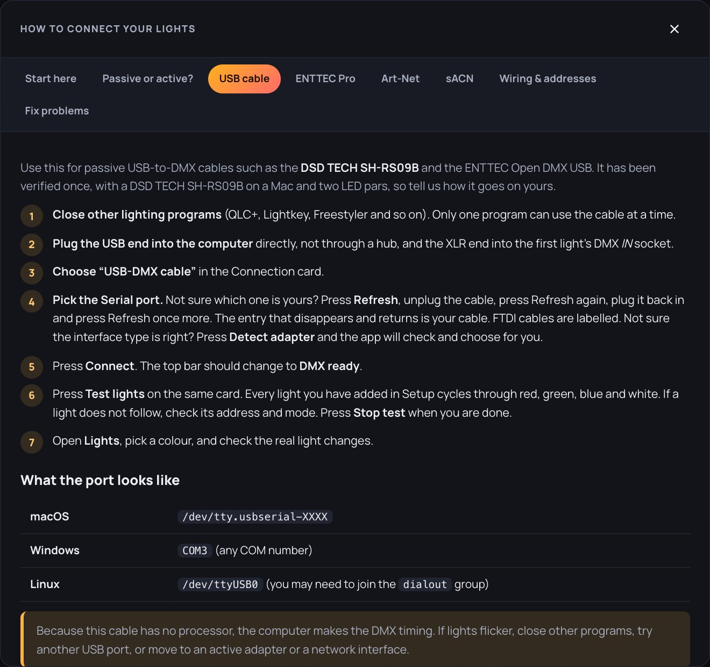

> This cable has no processor, so the computer produces the DMX timing. This option is **experimental and has not been
> tested on real hardware yet**. If lights flicker: close other programs, try a different USB port, or use an active
> adapter or a network interface.

### 5.3 ENTTEC DMX USB Pro (and DMXKing)

1. Close other lighting programs, plug the adapter in, and connect its DMX **OUT** to the first light's **IN**.
2. In **Output**, choose **ENTTEC DMX USB Pro**.
3. Pick the **Serial port** (use Refresh, or the unplug-and-replug trick above).
4. Press **Connect**, then test in **Lights**.

If you chose this and the lights do nothing, your adapter may be a passive one: try **USB-DMX cable** instead.

### 5.4 Art-Net (network)

Art-Net sends DMX over your network to an **Art-Net node** (a box that turns network data into DMX) or to another
lighting program.

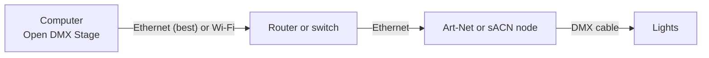

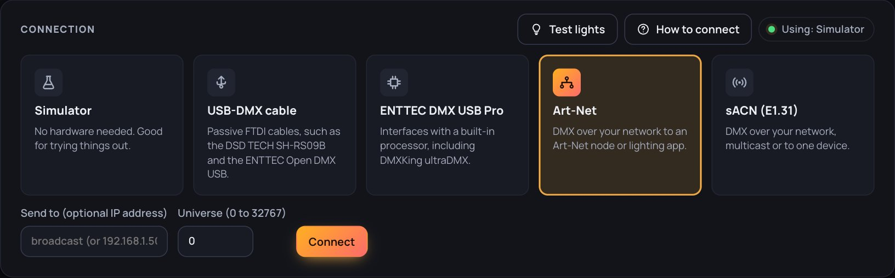

1. Put the computer and the node on the **same network**. A cable is much more reliable than Wi-Fi.
2. Find the node's **IP address** (its display or manual shows it, for example `192.168.1.50`). The computer should be on
   the same family of addresses (for example `192.168.1.x`).
3. In **Output**, choose **Art-Net**.
4. **Send to:** type the node's IP address (it must be an address on your own network, such as `192.168.1.50`; names like `node.local` are not accepted). Leave it empty to broadcast to everything on the network.
5. **Universe:** set the universe your node outputs. The default is **0**. Many nodes number universes from 1, so if
   nothing happens, try one number up or down.
6. Press **Connect**, then test in **Lights**.

No node yet? Any program that receives Art-Net on the same computer can act as a test target: set **Send to** to
`127.0.0.1`.

### 5.5 sACN / E1.31 (network)

sACN is set up like Art-Net, with two differences:

- **Send to:** leave it empty to use **multicast** (the standard way; it needs a network switch that supports it), or
  type the node's IP address (an address on your own network) to send straight to it. If nothing arrives with multicast, use the IP address.
- **Universe** starts at **1** (the default) and must match the universe your node listens to.

## 6. Wiring and addresses

### Addresses: how each light knows its job

Every light listens to a block of channels. **Setup** assigns each light a start address. You must set the **same start
address and the same mode** on the real light, using its display or switches. If they differ, the light reacts to the
wrong channels or not at all.

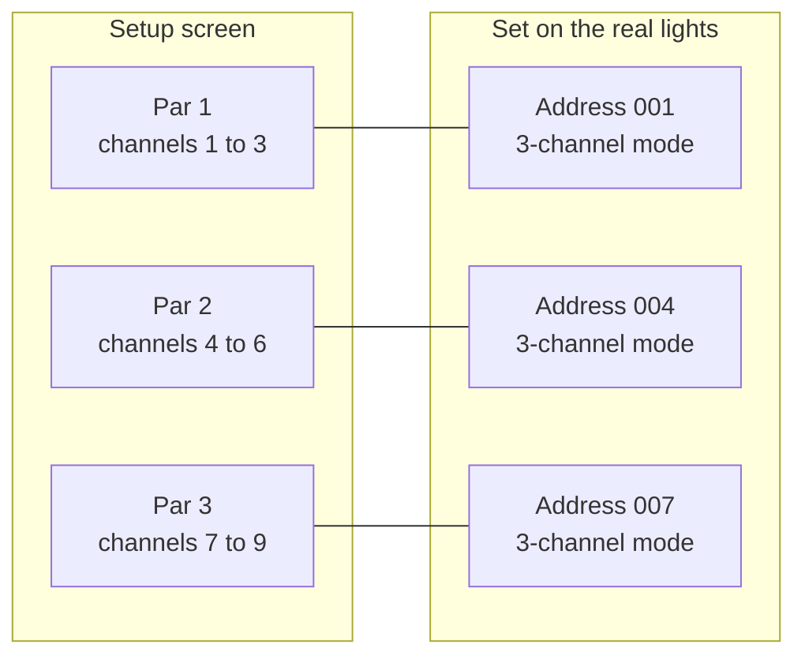

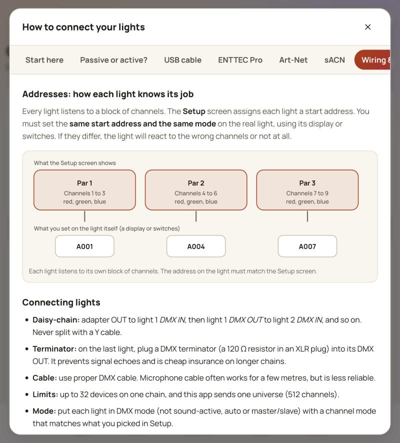

### Connecting lights

- **Daisy-chain:** adapter OUT to light 1 **DMX IN**, then light 1 **DMX OUT** to light 2 **DMX IN**, and so on. Never split
  the line with a Y cable.
- **Terminator:** on the last light, plug a DMX terminator (a 120 Ω resistor in an XLR plug) into its DMX OUT. It
  prevents signal echoes and is cheap insurance on longer chains.
- **Cable:** use proper DMX cable. Microphone cable often works for a few metres but is less reliable.
- **Limits:** up to 32 devices on one chain. This app sends one universe (512 channels).

### XLR pins

| Pin                  | Use                         |
| -------------------- | --------------------------- |
| 1                    | Ground (shield)             |
| 2                    | Data minus (−)              |
| 3                    | Data plus (+)               |
| 4 and 5 (5-pin only) | Spare, not used by this app |

If your adapter and lights use different plug sizes (3-pin and 5-pin), use a plain XLR adapter between them.

## 7. Test your connection

1. Open **Lights** and tap a bright colour such as **Red**, with Brightness at 100%. Check **Master** is up and
   **Blackout** is off.
2. The real light should change colour. If it does, you are done.
3. Open **Output**. You should see bars moving for the channels you patched. This shows what the app is sending, so if
   the bars move but the light does not, the problem is after the app (address, cable, adapter type).
4. Press **Blackout**. The light should go dark; press it again to bring it back.

## 8. What the status messages mean

| Message                              | Meaning                                                                                    |
| ------------------------------------ | ------------------------------------------------------------------------------------------ |
| **Simulator**                        | Nothing is sent to real lights. Normal until you connect an adapter.                       |
| **DMX ready**                        | The adapter or network output is open and the app is sending data.                         |
| **DMX not connected**                | The adapter could not be opened or was unplugged. Read the message in the Connection card. |
| **Server offline**                   | The app's server is not running. Start it again and reload the page.                       |
| "That serial port was not found"     | The cable moved or was unplugged. Press Refresh and choose the port again.                 |
| "Could not open…" or "Resource busy" | Another program is using the cable. Close it and press Connect again.                      |

If a saved cable is missing when the app starts, it falls back to the Simulator and tells you why, so the app always opens.

## 9. Troubleshooting

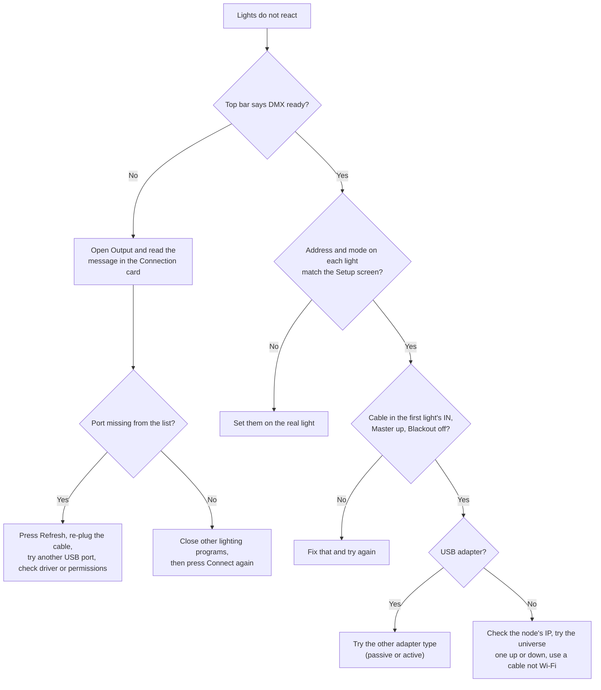

| What you see                                  | Try this                                                                                                                                                                                  |
| --------------------------------------------- | ----------------------------------------------------------------------------------------------------------------------------------------------------------------------------------------- |
| The port list is empty or missing your cable  | Press **Refresh**, re-plug the cable, try another USB port. On Windows or Mac you may need the FTDI driver. On Linux, join the `dialout` group.                                           |
| Says **DMX ready**, but the lights do nothing | Check each light's address and mode match Setup, the cable is in the first light's **IN**, Master is up and Blackout is off. For USB, try the other adapter type.                         |
| Lights flicker (USB cable)                    | Close other programs, avoid USB hubs, try another port, or use an active adapter or a network interface.                                                                                  |
| Art-Net or sACN does nothing                  | Same network? Type the node's IP in **Send to** instead of broadcasting. Check the universe number (try one up or down). Use a cable instead of Wi-Fi, and check the computer's firewall. |
| Some lights react, some do not                | Check addresses do not overlap (Setup shows a warning), add a terminator, and swap the cable before the first silent light.                                                               |
| Works in another program but not here         | Close the other program completely first; only one program can use a USB adapter.                                                                                                         |

Still stuck? Open an issue on the project's GitHub page and include: your adapter's name, your operating system, what the
top bar says, and any message shown in the Connection card.

## 10. Glossary

| Term                    | Meaning                                                                          |
| ----------------------- | -------------------------------------------------------------------------------- |
| **DMX (DMX512)**        | The standard signal that stage lights use. One line carries 512 channels.        |
| **Channel**             | One number (0 to 255) that controls one thing, such as the red level of a light. |
| **Universe**            | One full set of 512 channels. This app sends one universe.                       |
| **Address**             | The first channel a light listens to.                                            |
| **Mode**                | How many channels a light uses and what each does (for example 3-channel RGB).   |
| **Adapter / interface** | The box or cable that turns computer data into DMX.                              |
| **Passive adapter**     | A cheap cable with no processor; the computer makes the timing.                  |
| **Active adapter**      | An adapter with its own processor that makes the timing.                         |
| **Node**                | A network box that turns Art-Net or sACN into DMX.                               |
| **Art-Net / sACN**      | Two ways of sending DMX over a network.                                          |
| **Daisy-chain**         | Connecting lights one after another, OUT to IN.                                  |
| **Terminator**          | A 120 Ω plug in the last light's DMX OUT that stops signal echoes.               |
| **FTDI**                | The maker of the USB chip inside most USB-to-DMX adapters.                       |

## 11. FAQ

**Does this work with SoundSwitch dongles?** No. They use a proprietary protocol and are not supported.

**Can I use two adapters at once?** Not yet. The app sends one universe to one output at a time.

**Do I need a driver?** Often not, but some systems need the FTDI driver for USB adapters. If your port does not appear, see
the troubleshooting table above.

**Is it safe to try the wrong adapter type?** It is unlikely to cause harm and the lights simply do not respond, but this has not been tested on real equipment. Unplug your lights from the cable while you experiment if you want to be careful.

**Has this been tested on real lights?** The simulator and Art-Net output have been checked. The USB drivers follow the
published formats but have not been tested on real hardware yet, so report what you find.
