# Usage guide

A quick tour of Open DMX Stage. If you have not installed it yet, start with the [install guide](INSTALL.md).

The app has eight screens, reached from the left rail (or the bottom bar on phones and tablets), grouped under **Show**
and **Rig**:

| Screen        | What it is for                                                         |
| ------------- | ---------------------------------------------------------------------- |
| **Home**      | See the output and rig status, quick-launch pads, and what to do next. |
| **Lights**    | Pick colours and brightness and see your fixtures respond live.        |
| **Looks**     | Save what is on stage and bring it back with one tap.                  |
| **Sequences** | Chain looks into a show with timed fades.                              |
| **Perform**   | Run a show with pads, keyboard shortcuts and MIDI.                     |
| **Setup**     | Tell the studio which lights you have and their DMX addresses.         |
| **Fixtures**  | Describe your own lights: brand, model and what each channel does.     |
| **Output**    | See exactly what is being sent on the DMX line.                        |

The top bar is always available: the show name (click to rename), the connection status (with a **Fix** button when the
lights are not connected), **Search**, the **Master** brightness, the light/dark **theme switch**, and **Blackout**. The
**On stage** bar at the bottom of every screen says what is playing and has the button to stop it.

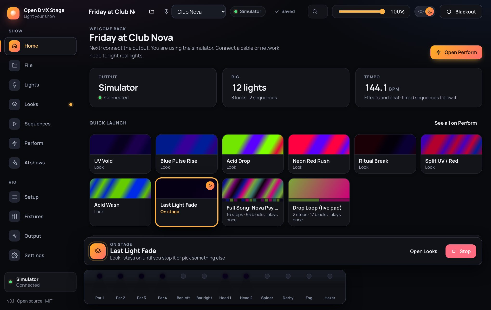

**Search (Ctrl or Command + K)** opens a palette from anywhere. Type a few letters to jump to a screen, play a look,
start or stop a sequence, or run an action such as Blackout, then press **Enter**. The arrow keys move through the
results and **Escape** closes it. Press **?** anywhere (outside a text field) to see every keyboard shortcut.

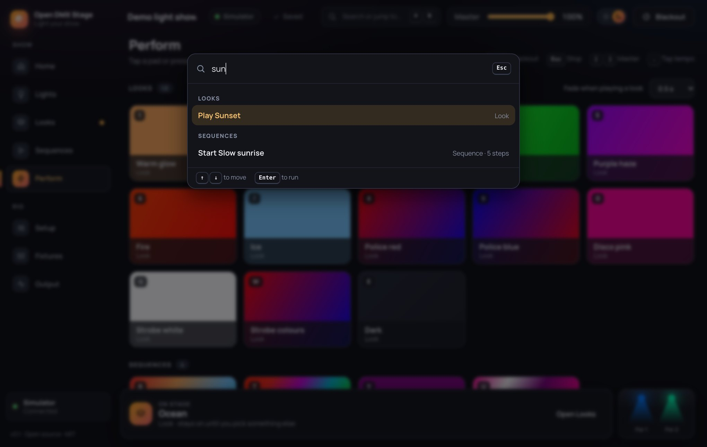

**Home** is the first screen. It shows the output, how many lights, looks and sequences you have, and the tempo, as cards
that open the right screen. While the show is unfinished a **Getting started** checklist (add lights, connect the output,
save a look, build a sequence) says what is next. **Quick launch** has pads for your looks and sequences. At the bottom right, a **live stage view** draws each of your lights as a lamp with a cone of light in the colour it is really sending.

## 1. First run: the welcome screen

The first time you open the app with an empty rig, a short welcome helps you get set up.

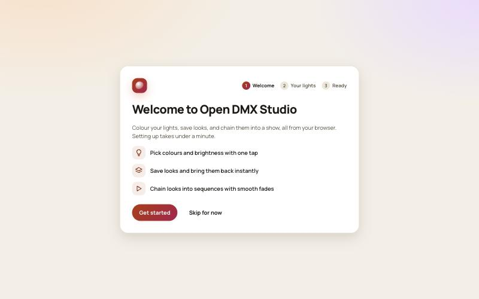

Choose **Get started**, then say how many of each light you have. Addresses are assigned automatically, one after
another, so fixtures never overlap.

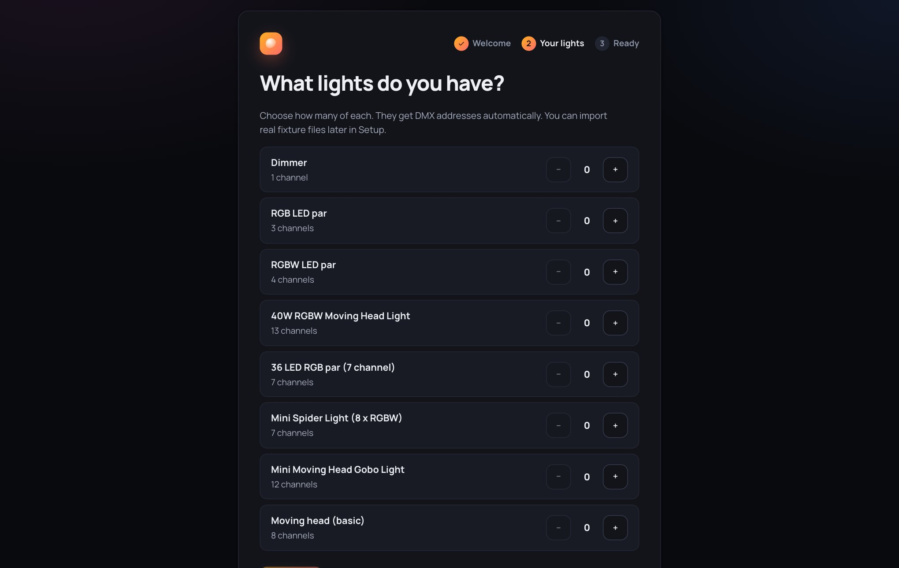

Finish with **Start lighting**. You can skip the welcome and add lights later in **Setup**.

## 2. Lights: colour and brightness

Your fixtures are big cards on the left (tap to select, or **Select all**) and the colour and brightness controls sit in
a panel on the right.

Open **Lights**. The studio at the top has quick colour swatches, a rainbow swatch for any custom colour, and a
**Brightness** slider. Pick a colour and your fixtures change immediately.

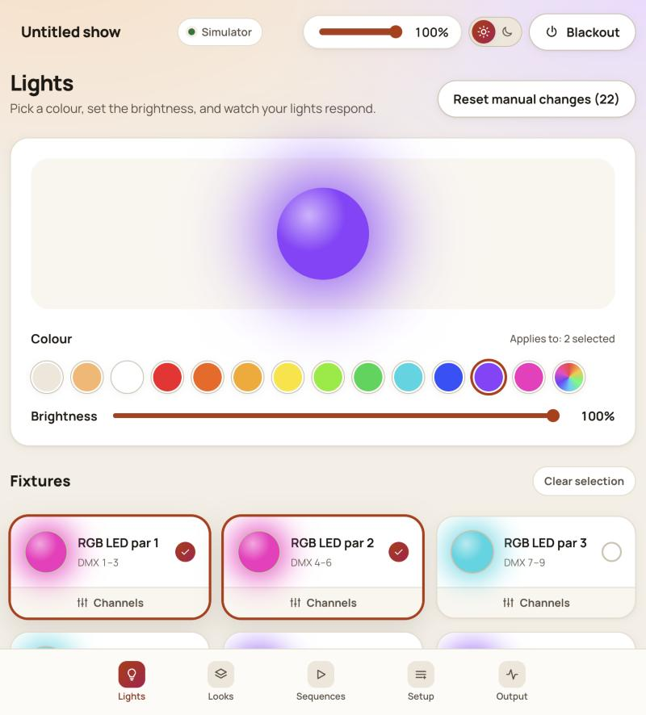

- **Which fixtures?** With nothing selected, changes apply to _all_ fixtures ("Applies to: all fixtures"). Tap
  fixture tiles to select just those ones ("Applies to: 2 selected"). Use **Clear selection** to go back to all.
- **Each tile** shows a glowing orb of the colour that fixture is emitting right now.
- **More controls:** with lights selected, the panel shows everything else they can do, grouped as Colour, Shutter,
  Movement, Beam, Atmosphere and Program: a slider for something continuous (pan, zoom, fog output) and a list for
  something with named settings (a gobo, a colour wheel slot, shutter open or strobe), with a level when that setting
  has one (a strobe's speed). They come from the fixture's channel ranges.
- **Fine control:** open **Channels** on a tile to move individual DMX channel faders (dimmer, red, green, pan, tilt
  and so on).
- **Reset manual changes** drops every manual fader or colour override and returns control to the running look or
  sequence.

> Fixtures with a dimmer channel keep the colour pure and use the dimmer for brightness. Fixtures without one scale the
> colour itself.

The same screen in the dark theme:

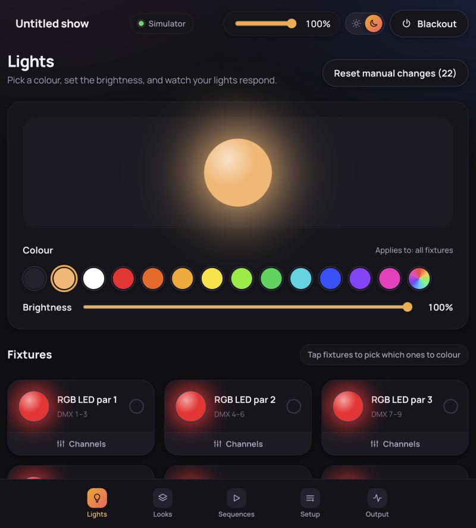

## 3. Looks: save and recall

Once the lights look right, open **Looks**, give the look a name and choose **Save current look**. Each saved look
becomes a card with a preview of its colours.

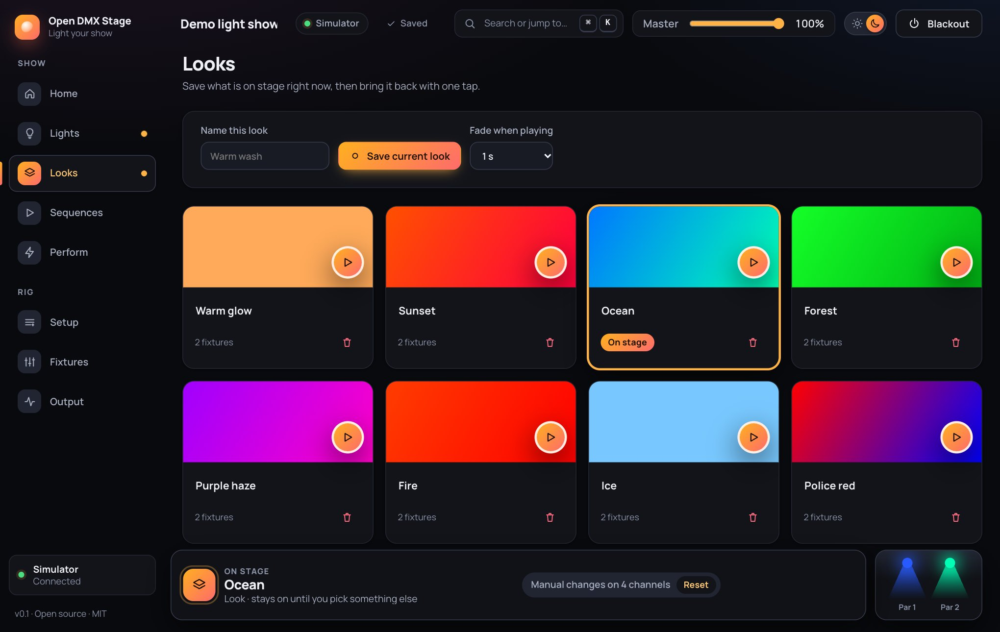

- Press the round **play** button on a card to bring that look up.
- **Fade when playing** sets how long the change takes (instant up to 5 seconds).
- The look currently on stage shows an **On stage** badge.
- Rename a look by clicking its name. Delete it with the bin icon (it is also removed from any sequence).
- Each card says how many of your lights the look sets, for example **2 of 4 lights**; point at it to see which
  lights it leaves dark.

**Adding lights later.** A look remembers the lights it was saved with, so a light added afterwards stays dark when
the look plays. When some lights are in none of your looks, the Looks screen says so and offers **Fill the new
lights**: in every look, each new light is set like a light of the same kind, in the order of your rig. With Par 1 and
Par 2 in your looks and Par 3 and Par 4 added, Par 1 is copied to Par 3 and Par 2 to Par 4, so each look keeps its
pattern across the four. Values a look already sets are never changed. **Not now** hides the offer for those lights in
this browser, for a light you left out on purpose.

## 4. Sequences: build a show

A sequence is a chain of your looks (its **steps**, each with a fade and a hold) and, if you like, coloured **blocks**
drawn for single lights over the top of them. Two views show the same sequence, chosen with the **Steps / Timeline**
toggle at the top of **Sequences**; the app remembers your choice. Switch at any time: a change in one view is in the
other.

- **Steps**: the chain of looks as a list. Under each step, a line says which blocks play during it.
- **Timeline**: the same chain laid out in time on a **Looks** lane, with a lane for each light underneath where you
  draw blocks.

A sequence can have steps only, blocks only, or both. Where a light has a block, the block decides what it does; where
it has none, the look playing at that moment does. Sequences play from Perform, Home, the search palette and MIDI, and
show in the **On stage** bar.

### Steps

A step sequence plays looks one after another.

1. Open **Sequences**, choose **Steps**, then **New sequence** (made from the Steps view, it is timed in seconds).
2. Choose **Add step** for each look you want, then pick the look for each step.
3. Set the **Fade** (seconds to transition in) and **Hold** (seconds to stay) for each step.
4. Turn **Loop** on to repeat forever, then press **Play**. Press **Stop** to end it.
5. Optional: change **Timing** from **Seconds** to **Beats** to time steps in beats instead. The fields become **Fade
   (beats)** and **Hold (beats)**, in quarter-beat steps, and the sequence speeds up or slows down with the tempo
   (see Tempo in the Perform section). Switching starts from the same lengths at 120 beats per minute. The tempo is
   read when each step begins, so a change takes effect from the next step.

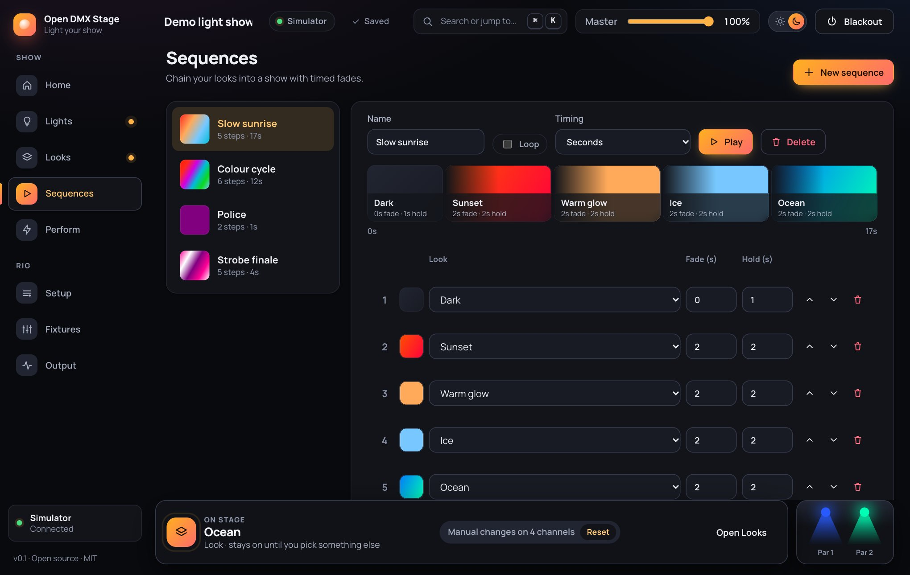

The **timeline** strip shows each look as a block sized by its fade plus hold time, with the fade drawn as a soft ramp.
The step that is playing is highlighted. Use the arrow buttons to reorder steps and the bin to remove one.

### Timeline

The Timeline view lays the sequence out in time on a grid of beats (with a stronger line at each bar) when it follows the
tempo, or of seconds when it is timed in seconds. The top lane, **Looks**, shows each step as a block of its look's
colours, as long as its fade plus hold, with the fade drawn lighter. Below it is one lane for each light in your rig.

- **Click a look** on the Looks lane to edit that step in the **Step** panel: its look, fade and hold, or **Remove
  step**. **Drag its right edge** to make it hold longer or shorter. **Add step** adds the next look at the end. Reorder
  steps in the Steps view.
- The sequence runs as long as its looks and blocks. **Length** makes it at least 1 to 64 bars (or a number of seconds)
  long, to leave room to draw.

1. Choose **Timeline**, then **New sequence** (made from the Timeline view, it follows the tempo), or pick a sequence
   you already have. Set its **Length** and the **Grid** (1, 1/2 or 1/4 beat), which is what blocks snap to. A
   timeline opens fitted to the width (**Fit**), however long it
   is. **+** and **−** above the grid zoom in and out (or hold **Ctrl** or **⌘** and turn the mouse wheel over it);
   zoomed in, the grid scrolls sideways: turn the mouse wheel over it, drag the bar numbers, or use the
   scrollbar under it. The light names stay in view. In Timeline mode the screen uses the whole
   width of the window.
2. **Drag across a lane** to draw a block over those beats. Drag across several lanes to draw the same block on each
   of those lights at once.
3. The new blocks are selected, and the **Block** panel beside the grid edits them all:
   - **Colour**: a swatch, or any colour with the picker.
   - **Intensity**: 0 to 100%.
   - **Transition**: **Fade** goes from the colour and intensity to a **Fade to** colour and an **End intensity**
     across the block. **None (hold)** keeps the colour.
   - **Effect**: **Strobe** flashes the light, with a **Strobe speed** from slow to fast. A strobing block is striped.
   - **Starts at beat** and **Length (beats)**, when one block is selected.
   - **What else the lights do**: everything else the selected lights can do, grouped as Colour, Shutter, Movement,
     Beam, Atmosphere and Program: pan and tilt, a colour wheel slot, a gobo, the shutter, zoom, fog output and so on.
     A setting is **Not set** until you choose it; with **Fade**, sliders also get an end value, so a moving head can
     sweep across a block. **×** clears a setting.

   New blocks are drawn in the look you chose last, so a run of similar blocks needs no repeated edits.

4. **Repeat** copies the selected blocks straight after themselves, keeping their lights and the gaps between them;
   the copies become the selection, so pressing **Repeat** again carries the pattern on. Draw one bar, then repeat it
   to fill a long timeline.
5. **Click** a block to select it, **Shift-click** to add more. **Drag** a block to move it (selected blocks move
   together), or drag its **right edge** to change its length. A click on an empty part of a lane clears the
   selection.
6. Press **Play**. A playhead shows where the timeline is, and the grid scrolls to follow it when zoomed in; press
   **Stop** to end it, or play it from Perform.

Where blocks overlap on a lane, the one drawn last plays. Where a lane has no block, that light shows the look playing
at that moment, or stays dark when there is none. Making a sequence shorter removes the blocks past the new end and
shortens those that run past it; the app asks first. Steps are never cut.

**From the keyboard:** the **+** beside a light's name adds a one-bar block on that lane. A block is a button: **Tab**
to it and press **Enter** to select it, **←** and **→** to move it by one grid step, **Shift** with **←** and **→** to
shorten or lengthen it, and **Delete** to remove it. Every setting is also in the **Block** panel.

### Export and import a sequence

**Export** saves the selected sequence as a file of its own (`name.sequence.json`), with the looks its steps use and
the lights it refers to. **Import sequence** adds one to your show, for example one made at another venue or shared by
a friend. Its lights are matched to your rig: first a light with the same name and fixture, then the next light of the
same fixture and mode. Looks and blocks move onto your lights' addresses, so a sequence made where the pars start at
channel 1 plays where they start at 101. A look identical to one you already have is reused instead of copied. The app
then says what came over, and which lights had no match (their blocks are left out).

## 5. Perform: run a show

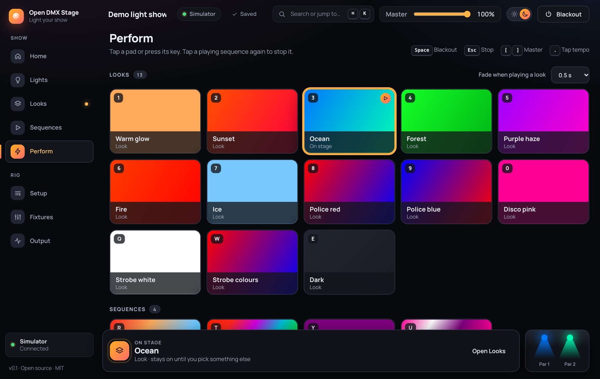

**Perform** turns every look and sequence into a pad, for running a show without hunting with the mouse. There is no
separate start button: **pressing a pad starts it**.

- **The status strip** at the top says, each with a dot and words, whether the **output** is ready, which **MIDI**
  controller is connected, and whether the page is listening to the **music**. Press **MIDI** or **Music** to jump to
  its settings. On the right, the **tempo** and four lamps that light in turn at its speed, one per beat of a bar (the
  first in the accent colour), so you can see the beat even without music. With reduced motion turned on, the lamps
  stay still.
- **Tap a pad** to play a look (with the fade chosen above the looks) or to start a sequence. Tap a playing sequence
  again to stop it.
- **Each pad** shows its colours and what it is: a look, or a sequence with its number of steps and whether it loops. A
  sequence pad has a strip with one colour per step; while it plays, the step on stage is lit and the pad says which
  step it is on (for example **On stage · step 2 of 5**).
- **Keyboard shortcuts:** each button shows its key (1 to 0, then Q to P, then A to L). **Space** is blackout,
  **Escape** stops a sequence, and **[** and **]** lower and raise the master by 10%. Shortcuts never fire while you are
  typing in a field.
- **Master, blackout and stop** live in the top bar and the **On stage** bar, which are on every screen, so Perform is
  the status strip, the pads, and the tempo, effects, music and MIDI controls. Looks and sequences are in their own rows,
  with the number of each, and the pad that is playing says **On stage**.
- **MIDI:** while learning, extra buttons appear to link blackout, stop and the master to a pad or knob.

### Auto show

The **Auto show** card plays your show by itself, with no music and no one at the controls, until you stop it.

- **Play:** your **Looks** or your **Sequences**. **Change:** how long each stays on, from **every bar** (four beats)
  to **every 8 bars**. **Order:** **In order**, or **Shuffled** (never the same one twice in a row). Then press **Start
  auto show**.
- It follows the **tempo**, so a faster tempo changes faster; type or tap a new tempo at any time. Looks fade into each
  other over one beat. Looks that leave every light off (such as "Dark") are skipped, so the stage never goes black.
- The **On stage** bar says **Auto show** and what is playing, with **Stop**. **Escape** stops it too, and the search
  palette has **Start the auto show** (looks, in order, every 2 bars) and **Stop the auto show**. Stopping leaves the
  current look on stage.
- **Pressing a pad takes over**: the auto show stops and your look or sequence plays. A blackout does not stop it; the
  show carries on underneath.
- The server runs it, so it keeps going if you close the page.

### Mute and solo

The **Mute and solo** card lists every light in your rig, with a **Mute** and a **Solo** button each.

- **Mute** keeps a light dark whatever plays: a look, a sequence, an effect or a manual change. Its pan and tilt still
  move. Press **Mute** again to let it play.
- **Solo** lights only the soloed lights; every other light stays dark. Solo several to light just those. Handy for
  checking one light, or for a spotlight moment.
- Each light says whether it is **Lit**, **Lit (solo)**, **Muted**, or **Dark** because another light is solo.
- While any light is muted or soloed, the **On stage** bar says so (for example "Muted: Par 2") with **Clear**, so a
  light is never left dark by mistake. **Clear all** on the card, and **Clear mute and solo** in the search palette,
  do the same.
- Mute and solo are live, like manual changes: they are not saved with the show, and restarting the server clears them.

### Tempo and effects

- **Tempo:** type the beats per minute, or press **Tap tempo** (or the **.** key) in time with the music. The first tap
  lines the beat up, and from the second tap the tempo follows your taps; a pause of two seconds starts a new count.
  **½×** and **2×** halve and double it. The tempo goes from 30 to 300.
- **Effects:** **Pulse** (every light swells on the beat), **Sweep** (a bright spot runs along the lights, in the order
  of your rig) and **Rainbow** (colours cycle through the spectrum, spread along the lights). Choose **All lights** or a
  group, and how many beats one cycle lasts. Press an effect again, or **Stop effect**, to end it. Effects lie over
  the look that is playing; master, blackout and any manual change still win. Pulse and sweep scale brightness, so
  they work with any look; rainbow sets red, green and blue on lights that have them. If you edit a group while an
  effect runs, press the effect again to pick up the change.
- Tempo and effects are live controls and are not saved in the show file.

### Follow the music

The **Follow the music** panel listens to the sound, finds the beat, and sets the tempo from it, so the effects (pulse,
sweep, rainbow) and the sequences timed in beats keep time with the music. Press **Start listening** and choose what to
listen to:

- **The microphone:** use this for music playing in the room. The browser asks for permission the first time.
- **A browser tab's sound:** the cleanest way for music in Chrome. Chrome asks what to share; choose the tab and tick
  **Also share tab audio**. The picture is thrown away and only the sound is used.
- **Music in another app** (Spotify, Music): macOS cannot hand app sound to a browser, so use the microphone, or install
  a loopback input such as BlackHole and choose it under **Microphone**.

The panel says **Listening… waiting for a steady beat** for the first four or five seconds while it learns the rhythm,
then **Following the beat: 128 beats per minute**, and the tempo above follows it. While it waits it shows how many beats
it has heard and the strongest rhythm it has found so far, so you can see it working (and hold the microphone nearer the
speaker if the level bar barely moves). It finds the tempo from how the sound's hits repeat rather than from the bass
alone, so it copes with bass lines, snares, hi-hats and the thin bass of a laptop microphone. Start an effect (for example
**Pulse**) or a sequence timed in beats (for example the demo show's **Colour cycle**) and it plays in time. Music without
any clear rhythm will not lock. If the sound stops for a few seconds the panel goes back to waiting. Press **Stop
listening** to let go of the microphone.

The sound is analysed inside the page by the browser and is never recorded or sent anywhere: only the tempo goes to the
server. There is a short delay between a sound and the light (a few tens of milliseconds), which is normal.

### MIDI controller

If you have a MIDI controller (pads, keys, knobs or faders), you can play looks from it:

1. Use Chrome or Edge, plug in the controller, and press **Turn on MIDI**. The browser asks for permission.
2. Press **Learn MIDI**, tap the button you want to link on the screen, then press a pad or key on the controller.
   The control's name (for example "Note 36 (ch 1)") appears on the button.
3. Press **Done learning**. Now the pad plays that look.
4. To control the master from a knob or fader, turn on learn mode, press **Link master to a knob**, and move the knob.

**Clear links** removes all links. Links are saved in this browser, not in the show file, and links to looks you delete
are forgotten. Safari and Firefox do not support MIDI everywhere, so use Chrome or Edge.

## 6. Setup: your rig

A **DMX map** at the top shows the 512 channels of the universe with a coloured block for each light, an outline where two
lights overlap, and the next free address.

Use **Setup** to manage your fixtures.

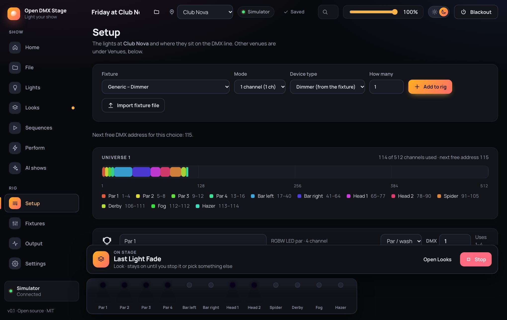

- **Add:** choose a fixture and mode, how many, then **Add to rig**. Addresses are picked for you.
- **Device type:** every light has a type (par, spot, moving head, scanner, LED bar, strobe, blinder, smoke machine,
  hazer, laser, dimmer and more, or **Other**), shown as an icon beside its name everywhere in the app. The app guesses
  it from the fixture; change it when adding lights, or on each light in the rig.
- **Edit:** rename a fixture or change its **DMX** address. A warning badge appears if fixtures overlap or run past
  channel 512.
- **Import fixture file:** load a fixture definition from a QLC+ `.qxf` file or an Open Fixture Library `.json` file.
  Imported fixtures then appear in the **Fixture** list. Only import files whose licence allows your use.
- **Remove:** the bin icon takes a fixture out of the rig (and out of any group).
- **Groups:** once you have lights, a **Groups** card lets you name sets of them, such as a front row, by ticking the
  lights in each. Effects on the Perform screen can run on just one group. Lights that are in no group are named under
  the groups, so lights added later are easy to spot.
- **Your show:** the **Your show** card has **Shows…**, which opens the show list (see Saving), and **Export show**.

### Venues

If you play the same show in different places, each with its own lights on its own DMX addresses, give each place a
**venue**. Your looks and sequences belong to the show and go with it; each venue has its own lights and groups. The
rig on Setup is always the venue you are at now, named at the top of the screen and in the **venue picker** beside
the show name in the top bar.

1. In the **Venues** card on Setup, type a name under **New venue**. Choose **Start with: the lights here** to copy
   this venue's lights (then change their addresses there), or **No lights** to start from nothing. Press **Add
   venue**.
2. Press **Switch here** on a venue (or pick it in the venue picker). The app says how many lights match one there
   and which do not, and asks before it switches.
3. Set up the lights there as usual: add, remove, re-address, group.

When you switch, each light is matched to one of the same fixture and mode at the other venue: the same light first
(in a copied venue), then one with the same name, then the next of its kind. Looks and sequence blocks move onto the
matched lights' addresses. A light with no match there loses nothing: what your looks do with it is kept aside and
comes back when you switch to a venue that has it. Rename a venue by editing its name; remove one with the bin (not
the one you are at). Output settings (cable, Art-Net and so on) are the same for every venue.

Make sure each fixture's real DMX address and mode match what is shown here.

**U`King 40W RGBW Moving Head Light:** choose **U'King 40W RGBW Moving Head Light**, mode **13 channel**. On the light's
display set **CH13** (13 channel mode) and its start address (**A001** and so on). The profile follows the maker's
manual: pan and tilt (with fine channels), speed, dimmer, strobe, and red, green, blue and white. Channels 12 and 13
are the light's built-in programs and its reset, so the app keeps them at 0; do not move them. The colour and
brightness controls work as on other lights, and pan and tilt are on the per-channel faders.

## 7. Fixtures: find or describe your lights

If a light is not in the list, find it online or describe it yourself on **Fixtures**.

### Find a fixture online

The **Find a fixture online** box searches the community-made [Open Fixture Library](https://open-fixture-library.org),
which has the channel layouts of thousands of lights.

1. Type a brand, a model or both (for example "uking gobo") and press **Search**. Punctuation does not matter.
2. Press **View details** to see a light before you add it: who wrote the definition, its size, weight and power, links to
   the manual and product page, and every mode with each channel's name, what it does, its resting value and what each
   range of values does. You can add it from there too.
3. Press **Add** next to your light. Its manufacturer, model and every mode are copied into **Your fixtures**, and the
   description credits the library and the people who wrote the definition.
4. In **Setup**, choose it and add it to your rig. Check that the mode matches the one set on the light's display.

Only your search words are sent to the library (through this app's server), nothing from your show. If you are
offline the box tells you so, and everything else keeps working; set `OFL_ENABLED=false` (see the install guide) to turn
the box off completely. Modes that repeat channels for every pixel are not supported yet: they are marked in the details window and left out
when you add the light (the description says which), and a light with only such modes is refused with a message.
Some entries only point to another brand's identical light; the app follows these for you.

### Describe a fixture by hand

If it is not in the library, or you prefer to enter it yourself, you need the channel table from the light's manual.

1. Choose **New fixture** (or open a built-in one and press **Make a copy**).
2. Fill in **Manufacturer**, **Model** and **Description** (for example "U'King", "40W RGBW Moving Head Light",
   "40W Beam Moving Head Light DMX512 RGBW Stage Light").
3. Name the **mode** the way the light's display does (for example "13 channel"), then list its channels in order. For
   each channel give a **Name**, choose **What it does** (dimmer, red, green, blue, white, pan, tilt, strobe, and so
   on) and set **Rests at**, the value the channel sits at when you have not moved it. **Ranges** lists what each
   range of values does (for example 0 to 9 open, 10 to 19 a star gobo, 20 to 255 strobe slow to fast), which the
   app turns into the controls on Lights and on timeline blocks. Use **Add channel**, the arrows
   and the bin to build the list. **Add mode** is for lights with more than one channel layout.
4. Choose the **Device type**, so the light gets the right icon.
5. In **Setup**, choose your fixture and mode and add it to the rig.

Choosing the right **What it does** matters: colours and the dimmer respond to the colour picker, master and blackout,
while **Other (fixed)** channels are never scaled. Use **Other** for anything that must stay put, with a **Rests at** that is
safe (for example 0 for a reset channel).

The built-in fixtures come from maker manuals: the generic dimmer, RGB and RGBW pars, a 36 LED RGB par (7 channel), a
mini spider light, mini gobo and beam moving heads, and the U'King head. Always check the channel count your light's
display shows before choosing a mode. The built-in **U'King 40W RGBW Moving Head Light** is a worked example: open it to see a real 13 channel layout, then
copy it to make changes. Built-in fixtures cannot be edited. Fixtures you make are saved in the show file (so Export
show takes them along), cannot be deleted while a light in the rig uses them, and cannot lose a mode while in use.

## 8. Output: see what is sent

**Output** shows all 512 DMX channels live, after Master and Blackout are applied. Each bar is a level; outlined cells
are channels used by your fixtures. Hover a cell for the fixture and channel name. It is handy for checking addresses
and for confirming that something is really being sent.

The **Connection** card at the top has two helpers for checking your setup:

- **Detect adapter** (for USB adapters): asks the adapter on the chosen port what kind it is and selects the matching
  interface for you. A passive cable stays silent; an adapter with its own processor answers.
- **Test lights:** cycles every light you have added through red, green, blue and white, so you can see at a glance
  that the connection and the DMX addresses are right. Press **Stop test** to put the lights back.

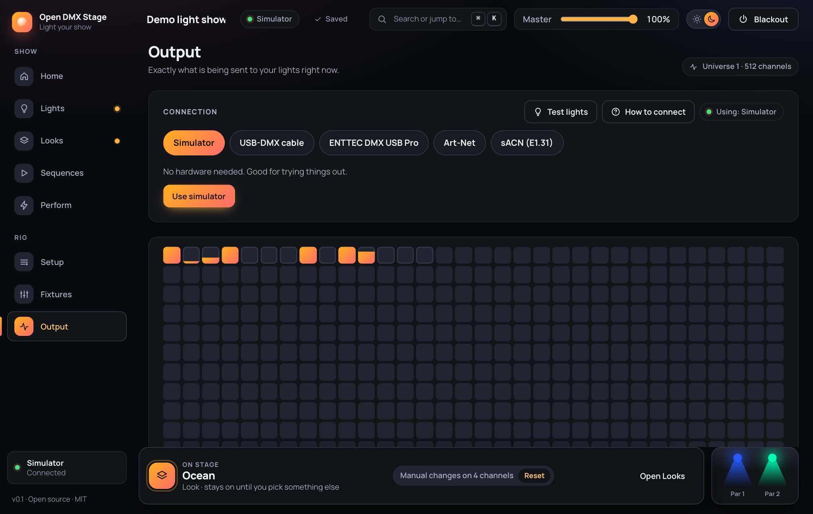

### Connecting your lights

The **Connection** card at the top of **Output** chooses how DMX leaves the app: the simulator, a USB-DMX cable, an
ENTTEC DMX USB Pro, Art-Net or sACN. Pick one, choose the serial port (or enter a network address and universe), and
press **Connect**. The status pill shows whether it is active, and any problem is explained in plain words.

Press **How to connect** in that card for a step-by-step guide with diagrams, including how to tell a passive USB cable
from an active adapter. The same guide is in [Connecting your lights](CONNECTION.md).

## 9. Master, Blackout, themes and devices

**The On stage bar.** The bar at the bottom of every screen always says what is playing: a sequence (with its step), a
look, or colours set by hand. Press **Stop** there to stop a sequence; the lights stay on its current look, and a second
**Stop** takes that look off stage and returns the lights to rest. The same **Stop** clears a look you played, or the
last look of a sequence that played once. Press **Reset** to drop manual changes, or **Stop effect** to end an effect. During a blackout it turns red and says the lights are off; press **Lights on** to bring
them back.

- **Master** scales the brightness of everything (dimmer and colour channels only; pan and tilt are unaffected).
- **Blackout** switches all light output off at once; press it again to bring it back.
- **Theme:** the sun/moon switch in the top bar changes between light and dark. The choice is remembered.
- **Phone and tablet:** below 900 px wide the navigation moves to a bottom bar and the layout stacks, so you can run
  the show from a phone or tablet on the same network (the server must be set to listen beyond this computer: see the
  [install guide](INSTALL.md#control-it-from-a-phone-or-tablet)).

## AI shows: let Claude design for your rig

**AI shows** (in the Show section of the sidebar) asks Claude, by Anthropic, to design looks and sequences for the venue
you are at, using everything its lights can do: colour, moving head sweeps, gobos, prisms, smoke bursts and so on. You
need your own Anthropic API key; each generation is billed to your Anthropic account (the app shows the tokens used and
an estimate in dollars).

1. **Add your key once:** open **Settings**, paste the key (it starts with `sk-ant-`) and press **Save key**. The app
   checks it with Anthropic and keeps it on the computer running Open DMX Stage. After that it only says _Key saved_:
   the key cannot be shown again, only replaced or removed. (A key set on the server as `ANTHROPIC_API_KEY` is used
   instead.)
2. **Optional, a song:** press **Choose a song**. The app listens to it in your browser and finds its tempo, its first
   downbeat and how its energy rises and falls, shown as a bar strip. If the tempo is twice too fast or slow, press
   **Half** or **Double**. Only these numbers are sent to the AI, never the audio.
3. **Your choices:** leave **Let the AI decide everything** ticked, or untick it to steer: a mood or style in your own
   words, the energy, colours to use more, use less or avoid, and **More**, **Less** or **Off** for each thing the
   lights at this venue can do (only what they have is offered: strobe always, movement only with moving heads, smoke
   only with a smoke machine or hazer, and so on). Choose how many looks and sequences, and their length when there is
   no song.
4. Press **Generate the show**. It usually takes one to three minutes. The new looks and sequences are added to your
   show; **Remove these** takes them out again.

With a song, the first sequence follows the whole song, section by section, plays once, and starts at the song's tempo.
Play the song from your deck, start the sequence on its first downbeat (from Perform or a MIDI pad), and turn on
**Follow the music** so the lights stay on the beat. Every AI look and sequence can be edited like any other.

What is sent to Anthropic: your lights' names, fixtures and controls, your choices, and the song's numbers. Nothing else
from your show, and never the audio.

## 10. Saving, and other shows

Your show (venues, fixtures, looks, sequences) saves automatically a moment after each change. The top bar shows
_Unsaved_, _Saving…_ or _Saved_. There is no Save button to remember.

Press **Shows** beside the show name in the top bar (or **Shows…** on Setup) to see the show list:

- **Open now:** the show you are working on, with **Export to a file** (a backup, or to take it to another computer)
  and **Import a show file**. An imported show opens as a show of its own; the one you were on goes to the list.
- **Save as:** keeps the show as it is now in the list, and carries on in a copy with the new name.
- **New show:** starts an empty show with that name; the one you were on goes to the list.
- **Your other shows:** **Open** one to work on it (the one you were on goes to the list, saved), or delete one with
  the bin. A show only exists once: in the list, or open.

Opening another show stops whatever is playing. Rename the open show by editing its name in the top bar.

The open show lives in `server/data/project.json` on the machine running the server (the previous save is kept as
`project.json.bak`), and the others in `server/data/shows/`. Files from older versions of the app are upgraded
automatically.

## Current limits

- One DMX universe (512 channels).
- Export to Engine DJ / SoundSwitch is not available yet.
- USB output has been verified with one passive cable (DSD TECH SH-RS09B) on one Mac with two LED pars. ENTTEC Pro adapters and network output (Art-Net and sACN) have not yet been tried on real lights, and nothing has been tried on Windows or Linux.
- SoundSwitch dongles are not supported.
